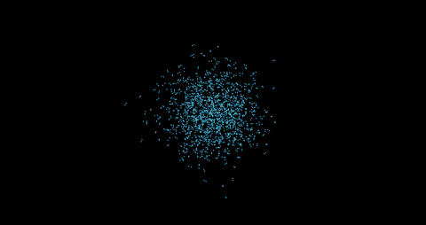

# sonic-brownian

**Visualização Computacional da Música: uma abordagem baseada em sistemas de partículas**

Anderson Aquiles, Felipe Giehl, Letícia Aleixo — IMPA Tech, 2026.2

> Projeto em desenvolvimento.

## Sobre

O sistema recebe um arquivo de áudio e gera um vídeo de partículas sincronizado com a música. O movimento das partículas segue um **passeio browniano condicionado**: em vez de passos equiprováveis em todas as direções, as probabilidades de deslocamento, a velocidade e a aceleração dependem, quadro a quadro, das características extraídas do som (frequência, intensidade, timbre e ritmo).

<p align="center">
  
  <br>
  <em>Os primeiros 10 s do vídeo gerado para "Can You Hear the Music" (Ludwig Göransson, trilha de Oppenheimer), com 1000 partículas.</em>
</p>

O projeto retoma uma tradição antiga de tornar o som visível, do *clavecin oculaire* de Castel às figuras de Chladni, usando ferramentas atuais de processamento de sinais e computação gráfica.

## Pipeline

```
áudio (WAV/MP3) → features → mapeamento → browniano condicionado → renderização → pré-visualização / MP4
                                   └──────→ paleta de cores ───────────┘
```

A simulação usa uma atualização de Langevin, em que γ é a fricção, μ a deriva, σ a intensidade do ruído e ξ um ruído gaussiano padrão:

```
v[t+1] = (1 − γ)·v[t] + μ·Δt + σ·√Δt·ξ
x[t+1] = x[t] + v[t+1]
```

Com γ = 1 e μ = 0, o modelo se reduz ao browniano puro.

### Entropia da nuvem (Fokker–Planck)

A nuvem é descrita também pela densidade ρ(x, t), que obedece à equação de Fokker–Planck da equação de Langevin acima. No limite superamortecido, a cada quadro:

```
∂ρ/∂t = −(μ/γ)·∇ρ + D ∇²ρ,        D = σ² / (2γ²)        (domínio toroidal)
S(t) = −∫ ρ ln ρ dA                                      (em nats; máximo ln(largura · altura))
```

`src/fokker_planck.py` estima ρ(x, 0) a partir das N partículas iniciais (as mesmas do vídeo) e a evolui numa malha periódica com os mesmos parâmetros por quadro de `mapping.py`. Como μ e D não dependem da posição, cada quadro tem solução exata no espaço de Fourier. O impulso dos ataques dilata ρ em torno do centro da nuvem (soma 2 ln λ à entropia) e o pulso negativo seguinte o desfaz. Aproximações: o limite superamortecido ignora a memória de velocidade (1/γ quadros) e o impulso age de uma vez, não ao longo de alguns quadros. `tests/test_fokker_planck.py` compara o resultado com o conjunto de partículas de Langevin.

```python
from src.pipeline import build_params, compute_entropy
params, _ = build_params("data/audio/songs/faixa.wav")
S = compute_entropy(params)    # S[i] é a entropia em t = i / fps
```

## Stack

Python com `librosa`, `numpy` e `scipy` (áudio e simulação), `pygame` (pré-visualização em tempo real), `imageio-ffmpeg` (exportação em vídeo), `matplotlib`, `pandas` e Jupyter (análise), FastAPI (API) e React com Vite (interface).

## Estrutura planejada

```
config/        presets YAML do mapeamento
data/audio/    faixas de teste e sinais sintéticos
src/
  features.py    extração e normalização
  mapping.py     features → parâmetros físicos e cores
  hyperparameters.py  ganhos, escalas, suavização, cor, rastro e resolução do vídeo
  color.py       conversão OKLCH → sRGB
  simulation.py  passeio browniano condicionado
  fokker_planck.py  densidade da nuvem (Fokker–Planck) e entropia no tempo
  conditional_visualization.py  pré-visualização com o áudio tocando
  render.py      exportação em vídeo
  pipeline.py    áudio → features → simulação, na janela ou em MP4
  api/           API HTTP (FastAPI): envio do áudio, acompanhamento e download do vídeo
frontend/      interface em React + Vite
notebooks/     exploração e figuras
tests/         testes do modelo
```

## Uso

```bash
pip install -r requirements.txt

# Pré-visualização com o áudio tocando
python -m src.pipeline <caminho_da_musica>

# Vídeo MP4 com o áudio, em data/videos/<faixa>.mp4 (ou no caminho de -o)
python -m src.pipeline <caminho_da_musica> --save_video
```

Em Python: `run_pipeline(caminho, save_video=True)`, de `src/pipeline.py`. O vídeo é renderizado fora da tela, um quadro por quadro de features, com o mesmo desenho da pré-visualização com `n_particles_export` partículas. A resolução do vídeo (`RESOLUTION` em `src/hyperparameters.py`: `low` 480p, `medium` 720p ou `high` 1080p, escolhível na interface) muda só o tamanho em que a nuvem é desenhada: a simulação e a entropia continuam no domínio `width`×`height` do `config/default.yaml`, então o movimento é o mesmo nas três.

### API

```bash
uvicorn src.api.main:app --reload    # documentação interativa em http://127.0.0.1:8000/docs
```

| Rota                             | O que faz |
|----------------------------------|-----------|
| `POST /api/videos`               | envia o áudio (formulário com `audio` e, opcional, `n_particles` até 200 000) e devolve um `task_id` |
| `GET /api/videos/{task_id}`      | estado da tarefa: `queued`, `running`, `completed` ou `failed` (com o erro) |
| `GET /api/videos/{task_id}/file` | baixa o MP4 quando a tarefa termina |
| `GET /api/videos/{task_id}/entropy` | entropia S(t) da nuvem ao longo da música (`time`, `entropy`, `max_entropy`), quando a tarefa termina |
| `GET /api/health`                | verifica se a API está no ar |

### Interface (React + Vite)

Precisa do Node 20.19 ou mais recente. Com a API rodando em outro terminal:

```bash
cd frontend
npm install
npm run dev    # http://localhost:5173
```


## Referências

1. Tzanetakis, G.; Cook, P. *Musical genre classification of audio signals*. IEEE Trans. Speech and Audio Processing, 2002.
2. Kramer, G. et al. *Sonification Report: Status of the Field and Research Agenda*. 1999.
3. Kubelka, O. et al. *Interactive music visualization*. CESCG, 2000.
4. Barnet, E. H. *A perfect fifth of blue and red: Enlightened harmonies of the senses*. J. Canadian Historical Association, 2019.
5. Ullmann, D. *Life and work of E.F.F. Chladni*. Eur. Phys. J. Special Topics, 2007.

## Licença

[MIT](LICENSE)
